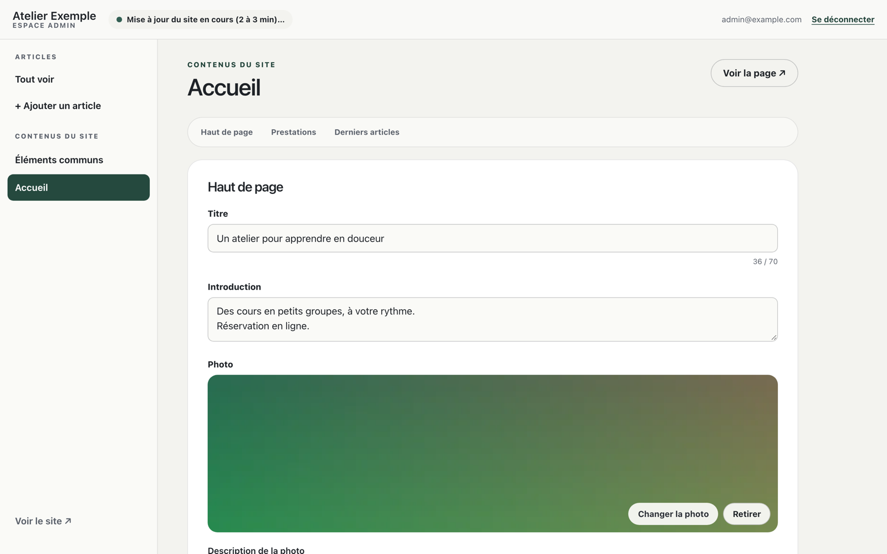
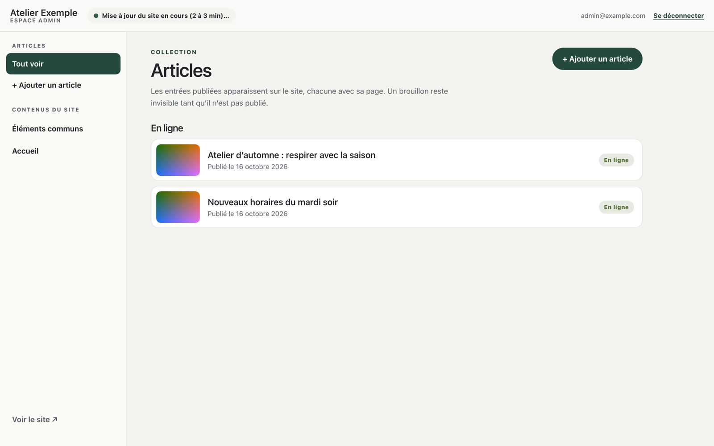
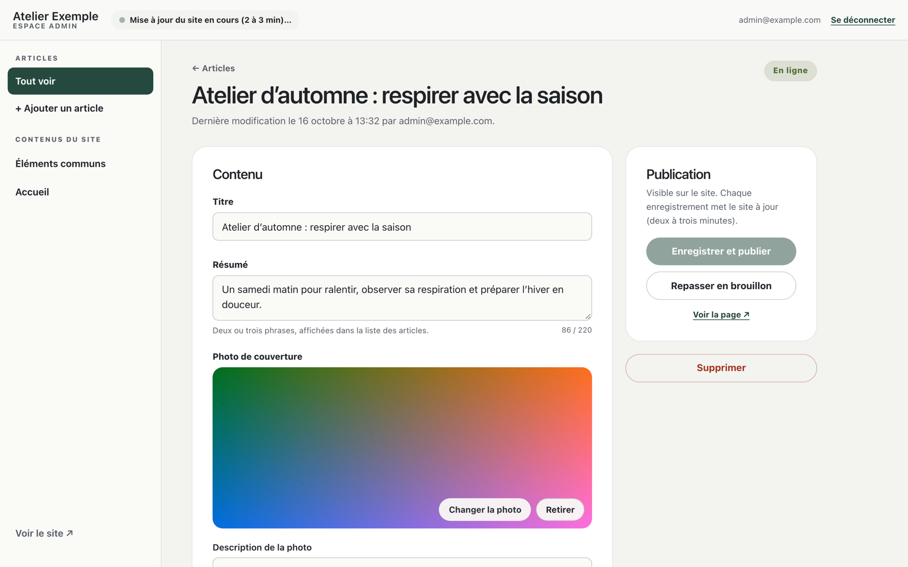

# nohu-cms

[](https://www.npmjs.com/package/nohu-cms)
[](https://github.com/davidbarbi3r/nohu-cms/actions/workflows/ci.yml)
[](LICENSE)

**Un espace admin pour sites Astro statiques, hébergé sur Cloudflare.**
Vos clients modifient eux-mêmes les textes, les photos et publient des
articles ; le site reste 100 % statique, rapide et sans serveur à maintenir.

> _An admin panel for static Astro sites on Cloudflare (Workers, D1, R2,
> Access). The admin UI is in French._



## Pourquoi

Un site vitrine Astro est rapide et simple à héberger… jusqu'au jour où le
client veut changer un horaire, une photo ou publier une actualité. nohu-cms
ajoute une page `/admin` pensée pour une personne non technique, sans
abandonner le rendu statique : chaque enregistrement relance le build sur
Cloudflare, qui republie le site en 2 à 3 minutes.

## Fonctionnalités

- **Tout se déclare dans un fichier** (`cms.config.ts`) : pages → sections →
  champs, et collections (articles, événements…). L'admin se génère toute
  seule, avec libellés et aides en français simple.
- **Textes, textes mis en forme, listes réordonnables, dates, liens, choix**,
  avec validation et compteurs de caractères.
- **Photos** : les images du site restent dans `src/` et sont **optimisées au
  build** par `astro:assets` ; la cliente peut les remplacer depuis l'admin
  (redimensionnées dans le navigateur, stockées dans R2, servies en `srcset`).
- **Articles** avec brouillons, photo de couverture, pages générées.
- **Suivi réel de la mise en ligne** dans l'admin (en cours, en ligne, échec)
  et alerte en cas d'échec.
- **Sécurité** : connexion par Cloudflare Access (code reçu par email), jeton
  vérifié par le Worker, liste d'emails autorisés, contrôle d'origine, HTML
  nettoyé au build. Chaque site a sa base, son stockage et son application
  Access : un client ne voit jamais un autre site.
- **Mise en service guidée** : `init`, `setup` (un seul jeton API), `doctor`.

| Articles                                              | Fiche d'un article                                     |
| ----------------------------------------------------- | ------------------------------------------------------ |
|  |  |

## Comment ça marche

```
Admin (/admin) ──► Worker du site : /api/admin ──► D1 (textes, articles)
                                │              └► R2 (photos, /media/*)
                                └► Deploy hook ──► Workers Builds
                                                   astro build (lit D1) ──► wrangler deploy
```

Le site reste un build Astro statique. Le Worker ne sert que l'API de l'admin
et les photos ; tout le reste est servi comme fichiers statiques.

## Démarrage rapide

Dans un site Astro existant (rendu statique) :

```bash
npm i nohu-cms
npm i -D wrangler @cloudflare/workers-types
npx wrangler login
npx nohu-cms init                                   # fichiers du site, D1, R2
CLOUDFLARE_API_TOKEN=<jeton> npx nohu-cms setup     # Access, secrets, builds
npx nohu-cms doctor                                 # tout vérifier
```

Puis déclarez vos contenus :

```ts
// cms.config.ts
import {
  asset,
  collection,
  defineCms,
  image,
  page,
  richtext,
  section,
  text,
  textarea,
} from 'nohu-cms';

export default defineCms({
  admin: { title: 'Atelier Dupont', brandColor: '#2f5d50' },
  pages: {
    accueil: page('Accueil', '/', {
      hero: section('Haut de page', {
        title: text('Titre', 'Bienvenue', { max: 70 }),
        photo: image('Photo', asset('assets/photos/atelier.jpg', 'L’atelier')),
      }),
    }),
  },
  collections: {
    articles: collection('Articles', {
      itemLabel: 'un article',
      path: '/blog/[slug]',
      fields: {
        summary: textarea('Résumé'),
        cover: image('Photo'),
        body: richtext('Texte'),
      },
    }),
  },
});
```

```astro
---
import config from '../../cms.config';
import { getContent } from 'nohu-cms/content';
import CmsImage from 'nohu-cms/components/CmsImage.astro';

const { accueil } = await getContent(config);
---

<h1>{accueil.hero.title}</h1>
<CmsImage image={accueil.hero.photo} sizes="100vw" />
```

**Documentation complète** (champs, images, collections, suivi des mises en
ligne, sécurité, CLI) : [packages/nohu-cms/README.md](packages/nohu-cms/README.md).

Avec Claude Code, `npx nohu-cms skill` installe un skill qui fait
l'installation et transforme les textes écrits en dur dans vos pages en
contenus modifiables.

## Prérequis

- Astro ≥ 5 en rendu statique, Node ≥ 20 (npm ou bun).
- Un compte Cloudflare (l'offre gratuite suffit : Workers, D1, R2, Zero Trust).
- Le dépôt du site connecté à Workers Builds.

## Feuille de route

Les prochaines étapes (aperçu avant publication, renommage de champs sans
perte, nouveaux types de champs…) sont suivies dans les
[issues](https://github.com/davidbarbi3r/nohu-cms/issues).

## Développement

```bash
npm install
npm run build          # package (modules + admin précompilée)
npm test               # tests unitaires (vitest)
npm run test:e2e       # admin de bout en bout (Playwright, site d'exemple)
npm run lint && npm run check
```

- `packages/nohu-cms` : la lib.
- `playground` : site d'exemple (accueil + blog) ; admin locale avec
  `cd playground && npx nohu-cms dev`, puis http://localhost:8788/admin.
- `docs/specs` : conception.

Publier une version : mettre à jour `version` et le CHANGELOG, pousser un tag
`vX.Y.Z` (il doit correspondre à la version du package). Le workflow `release`
vérifie tout puis dépose la version sur npm **en attente**, sans jeton (Trusted
Publisher). Elle est mise en ligne une fois validée avec la double
authentification, sur npmjs.com (« Staged Packages ») ou avec
`npm stage approve <id>`.

## Licence

[MIT](LICENSE) © David Barbier
